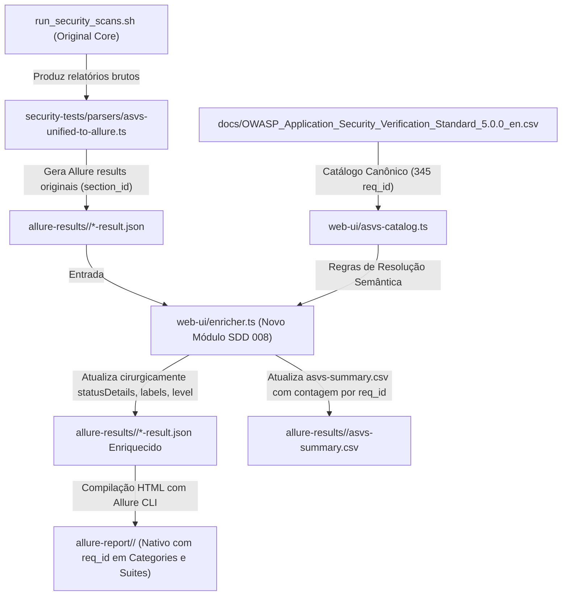

# Implementation Plan: Allure Native Results Granular Requirement (`req_id`) Enrichment (`008-allure-results-req-id-enrichment`)

## 1. Arquitetura da Solução

O módulo enriquecedor atuará de forma desacoplada entre a geração dos resultados brutos e a compilação do relatório Allure:



## 2. Componentes e Contratos de Interface

### 2.1 `web-ui/enricher.ts`
Função principal:
```typescript
export interface EnrichmentStats {
  totalProcessed: number;
  enrichedCount: number;
  byReqId: Record<string, number>;
  byLevel: Record<string, number>;
}

export function enrichAllureResultsDir(
  resultsDir: string,
  catalog: AsvsCatalog,
  options?: { updateSummaryCsv?: boolean }
): EnrichmentStats;
```
Lógica de Transformação por `-result.json`:
1. Identifica a ferramenta (`feature` ou `Tool:...`), `name`, `fullName`, e `statusDetails.message`.
2. Invoca `resolveFindingToReqIds(input, catalog)`.
3. Se `req_id` identificado:
   - Substitui `ASVS: [Vv]\d+\.\d+(\s*\[[^\]]+\])?` por `ASVS: ${match.reqId} [${match.level}]`.
   - Substitui ou adiciona tag `ASVS:5.0.0/${match.reqId}`.
   - Atualiza label `level` para `match.level`.
   - Atualiza label `subSuite` para `${match.reqId} - ${match.reqDescription.slice(0, 50)}`.
   - Preserva severidade, steps, attachments e UUID inalterados.
4. Gera versão atualizada de `asvs-summary.csv` contendo as colunas `req_id`, `chapter`, `section`, `level`, `failures`, `scanners`.

### 2.2 Integração em `web-ui/runner.ts`
No método `runScan`:
- Logo após o término da execução do processo CLI (`code === 0`), chama `enrichAllureResultsDir(allureResultsDir, catalog)`.
- Invoca a compilação do Allure Report via binário local `./security-reports/_bin/allure-2.29.0/bin/allure generate allure-results/<repo> --clean -o allure-report/<repo>`.

### 2.3 Integração em `web-ui/server.ts`
- Novo endpoint: `POST /api/enrich/:repo` para enriquecer e recompilar o relatório sem precisar reexecutar todos os scans demorados de segurança.

## 3. Conformidade com a Constituição
- **Princípio I (Zero Core Modification):** Nenhuma linha dos scripts de `security-tests/` ou tabelas `shared-*.json` é modificada.
- **Princípio V (Stack Nativa):** TypeScript 5.4, Node.js nativo (módulos `fs`, `path`), sem novas dependências externas.

