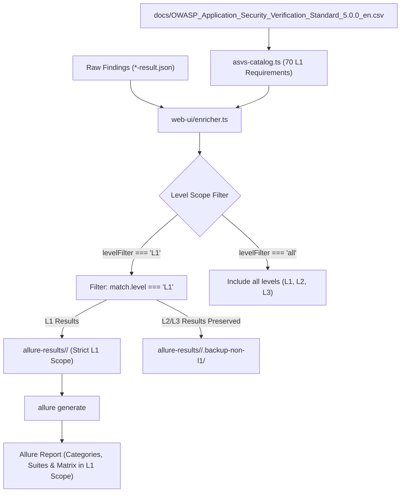

# Implementation Plan: OWASP ASVS v5.0.0 Level 1 (L1) Verification Scope & Filtering (`009-asvs-level-1-scope-filter`)

## 1. Arquitetura Técnica

## 2. Componentes e Modificações

### 2.1 `web-ui/enricher.ts`
- Adicionar opção `levelFilter?: 'L1' | 'all'` (padrão `'L1'`).
- Quando `levelFilter === 'L1'`:
  - Resultados classificados como `L2` ou `L3` são movidos para `resultsDir/.backup-non-l1/` ou excluídos de `resultsDir` para que o Allure CLI compile apenas os testes de nível 1.
  - Resultados `L1` (e artefatos de rollup/notas) são mantidos e enriquecidos com `ASVS: <req_id> [L1]`.
  - `asvs-summary.csv` é gerado contendo os requisitos L1 violados e consolidados frente aos 70 requisitos L1 do catálogo.
- Adicionar suporte a CLI flags: `--level L1` ou `--level all`.

### 2.2 `web-ui/asvs-catalog.ts`
- Adicionar helper:
  `filterRequirementsByLevel(catalog: AsvsCatalog, level: 'L1' | 'L2' | 'L3'): AsvsRequirementRecord[]`
  Retornando exatamente os 70 itens L1.

### 2.3 `web-ui/allure-plugin.ts`
- Na aba `#asvs-matrix`:
  - Exibir pill / toggle de escopo: **"Nível 1 (70 Requisitos — Escopo Automatizado)"** (ativo por padrão).
  - No Scoreboard:
    - Requisitos L1 Avaliados: 70
    - Requisitos L1 Violados: $N$
    - Requisitos L1 Conformes: $70 - N$
    - Índice de Conformidade L1: $((70 - N) / 70) \times 100\%$

### 2.4 `web-ui/server.ts` & `web-ui/runner.ts`
- Aceitar parâmetro `level` em `POST /api/enrich/:repo?level=L1` e em `runner.ts` options (`opts.asvsLevel`).

## 3. Conformidade com a Constituição
- **Princípio I (Zero Core Modification):** Nenhuma alteração nos arquivos upstream (`security-tests/`, `shared-*.json`).
- **Princípio V (Stack Nativa):** TypeScript 5.4, Node.js nativo.

