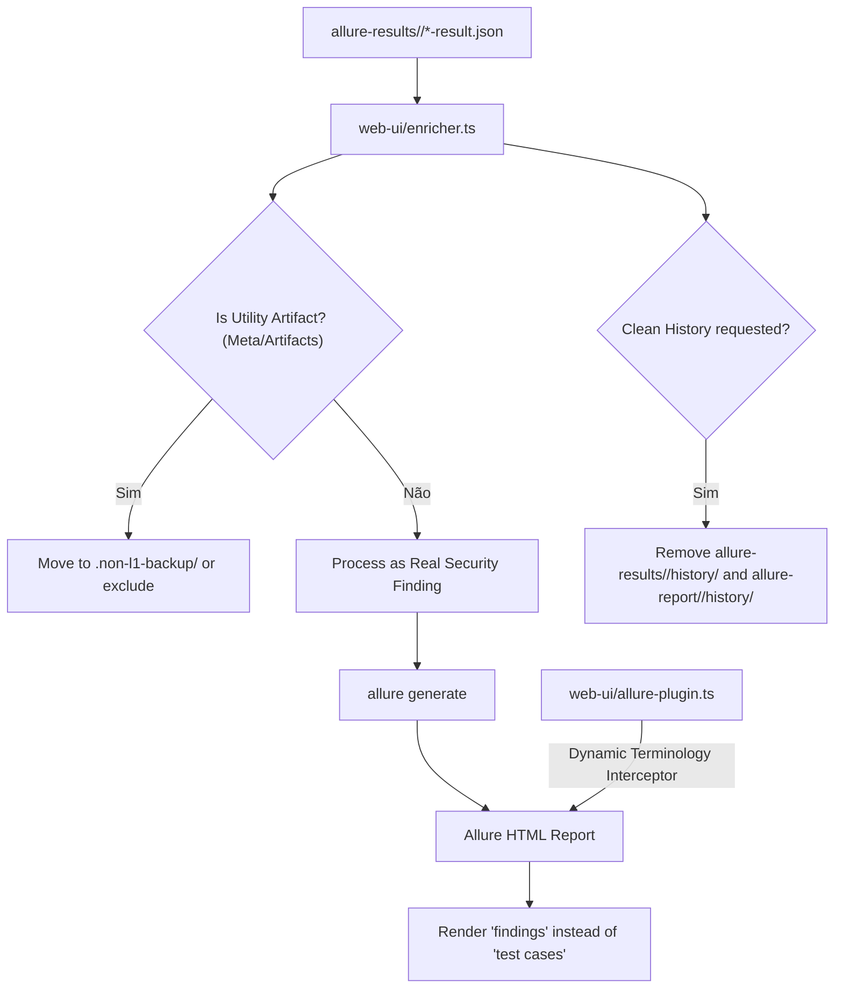

# Implementation Plan: Pure Security Findings Standard & History Reset (`010-finding-terminology-and-history-cleanup`)

## 1. Arquitetura da Solução

## 2. Componentes e Modificações

### 2.1 `web-ui/enricher.ts`
- Adicionar opção `excludeUtilityArtifacts?: boolean` (padrão `true`).
  - Quando ativado, resultados com `feature === 'Meta'` ou `feature === 'Artifacts'` (ou sem token de severidade) são movidos para `.non-l1-backup/` para não poluir a contagem de vulnerabilidades.
- Adicionar opção `cleanHistory?: boolean` (padrão `true`).
  - Quando ativado, remove os arquivos em `resultsDir/history` e `reportDir/history` antes de invocar `allure generate`.

### 2.2 `web-ui/allure-plugin.ts`
- Em `getAllurePluginJs()`:
  - Injetar manipulador no DOM / MutationObserver que intercepta:
    - `.chart__caption-text`: altera texto de `"test cases"` para `"findings"`.
    - `.widget__title` / cabeçalhos onde houver referência a "test cases".
  - Em `getAllurePluginCss()`:
    - Ajustar estilos do widget para visualização harmoniosa.

### 2.3 `web-ui/server.ts` & CLI
- Suporte aos parâmetros na CLI (`npm run enrich juice-shop -- --level L1 --clean-history`).
- Suporte aos parâmetros na rota `POST /api/enrich/:repo?level=L1&cleanHistory=true`.

## 3. Conformidade com a Constituição
- **Princípio I (Zero Core Modification):** Nenhuma alteração nos arquivos upstream (`security-tests/`, `shared-*.json`).
- **Princípio V (Stack Nativa):** TypeScript 5.4, JavaScript Vanilla no plugin, Node.js nativo (`fs`, `path`).

