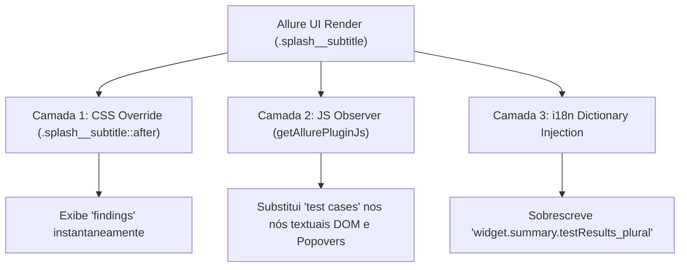

# Implementation Plan: Complete Finding Terminology Standardization across Allure UI (`011-complete-finding-terminology-standardization`)

## 1. Arquitetura da Solução



## 2. Componentes e Modificações

### 2.1 `web-ui/allure-plugin.ts`
1. Em `getAllurePluginCss()`:
   Adicionar:
   ```css
   .splash__subtitle {
     font-size: 0 !important;
     color: transparent !important;
     line-height: 0 !important;
   }
   .splash__subtitle::after {
     content: "findings" !important;
     font-size: 15px !important;
     color: #607d8b !important;
     display: block !important;
     text-transform: lowercase !important;
     letter-spacing: 0.5px !important;
     line-height: 1.4 !important;
     font-weight: 500 !important;
   }
   ```
2. Em `getAllurePluginJs()`:
   - Adicionar manipulador dinâmico visando `.splash__subtitle`, `.chart__caption-text`, `.popover__list`, `.widget__title`.
   - Adicionar dicionário i18n via `allure.api.addTranslation`.
3. Invocação de `installAllureCliPlugin` para propagar para a distribuição do Allure CLI.

## 3. Conformidade com a Constituição
- **Princípio I (Zero Core Modification):** O núcleo upstream em `security-tests/` e os arquivos `shared-*.json` continuam 100% intocados.
- **Princípio V (Stack Nativa):** TypeScript 5.4, CSS e JavaScript nativos.

