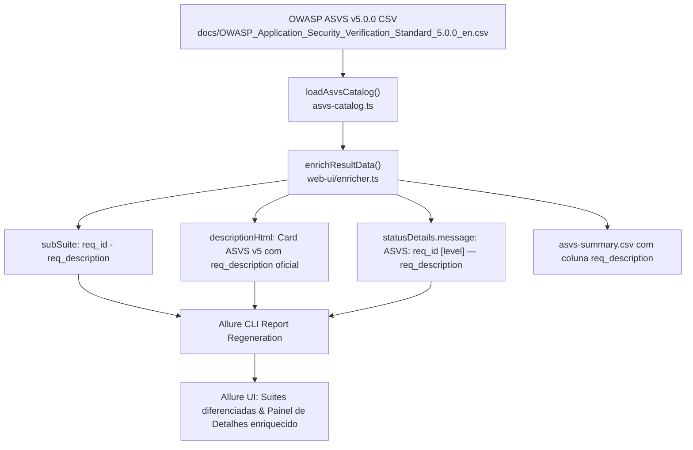

# Implementation Plan: Detailed ASVS Requirement Descriptions (`012-detailed-asvs-req-descriptions`)

## 1. Arquitetura da Solução

## 2. Componentes Afetados

1. **`web-ui/enricher.ts`**:
   - Atualizar a atribuição da label `subSuite` para `${primary.reqId} - ${primary.reqDescription}`.
   - Atualizar `descriptionHtml` e `description` de cada arquivo `-result.json`.
   - Atualizar a linha de cabeçalho e injeção em `statusDetails.message` com `reqDescription`.
   - Incluir a coluna `req_description` em `asvs-summary.csv`.
2. **`web-ui/runner.ts`**:
   - Atualizar a interface e o parser `parseAsvsSummaryCsv` para carregar `reqDescription` / `req_description`.
3. **`web-ui/enricher.test.ts` & `web-ui/runner.test.ts`**:
   - Atualizar/adicionar testes unitários validando a presença de `reqDescription` no `subSuite`, em `descriptionHtml` e no CSV gerado.
4. **Execução de Enriquecimento e Recompilação**:
   - Executar `npm run enrich juice-shop -- --level L1 --clean-history` para atualizar os resultados e o relatório HTML.

