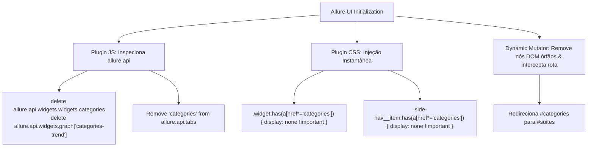

# Implementation Plan: Removal of Redundant Categories (`013-remove-categories-redundancy`)

## 1. Arquitetura da Solução

## 2. Componentes Afetados

1. **`web-ui/allure-plugin.ts`**:
   - Adicionar regras de ocultação CSS em `getAllurePluginCss()`.
   - Adicionar remoção programática de `categories` dos registros da API Allure em `getAllurePluginJs()`.
   - Adicionar supressão contínua no laço `standardizeFindingsTerminology()`.
   - Adicionar listener de redirecionamento de rota para `#categories` $\to$ `#suites`.
2. **`web-ui/runner.test.ts`**:
   - Adicionar teste unitário verificando a presença das regras de supressão de Categories em CSS e JS.
3. **Instalação e Recompilação**:
   - Recompilar e reinstalar o plugin na distribuição Allure via `npm run enrich juice-shop -- --level L1 --clean-history`.
   - Reiniciar o servidor web daemon e validar visualmente.

