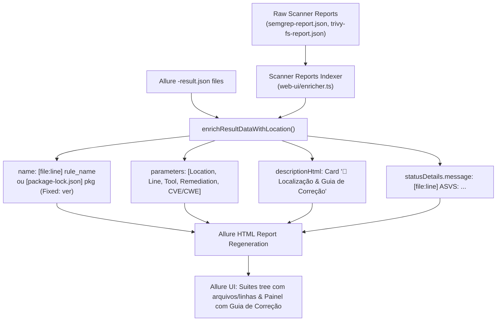

# Implementation Plan: Precise Finding Location & Remediation Context (`014-precise-finding-location-and-remediation`)

## 1. Arquitetura da Solução

## 2. Componentes e Estruturas de Dados

1. **Indexador de Relatórios Brutos (`loadRawReportsIndex(workspaceDir)`):**
   - Lê `security-reports/semgrep-report.json` e mapeia `${path}::${check_id}` $\to$ `{ line, col, snippet, message, cwe, owasp }`.
   - Lê `security-reports/trivy-fs-report.json` e mapeia `${target}::${pkgName}` $\to$ `{ installedVersion, fixedVersion, cveId, primaryUrl, title }`.
   - Lê `security-reports/gitleaks-report.json` $\to$ `{ file, line, rule }`.
2. **Resolução de Localização e Remediação (`resolveFindingLocationContext`):**
   - Extrai o alvo principal de `data.fullName` (ex: `routes/basketItems.ts` de `routes/basketItems.ts :: ajinabraham...`).
   - Correlaciona com os relatórios indexados.
   - Gera:
     - `filePath`: caminho relativo do arquivo no repositório.
     - `line`: número da linha (ex: `68`).
     - `codeSnippet`: trecho de código onde aplicável.
     - `fixedVersion`: versão segura da dependência (para SCA).
     - `remediationGuidance`: recomendação acionável de correção.
3. **Enriquecimento do Caso de Teste (`enrichResultData`):**
   - Atualiza `data.name` com o prefixo de localização.
   - Preenche `data.parameters` com os pares chave/valor nativos do Allure.
   - Insere o cartão de remediação em `data.descriptionHtml`.
4. **Idempotência no Enriquecedor (`enrichAllureResultsDir`):**
   - Garante que a pasta `.non-l1-backup` seja restaurada antes de cada ciclo de filtragem, permitindo reexecuções seguras sem perda de dados.
5. **Testes Automatizados (`web-ui/enricher.test.ts`):**
   - Testar extração de arquivo e linha no nome e parâmetros.
   - Testar inclusão do cartão de remediação em `descriptionHtml`.

