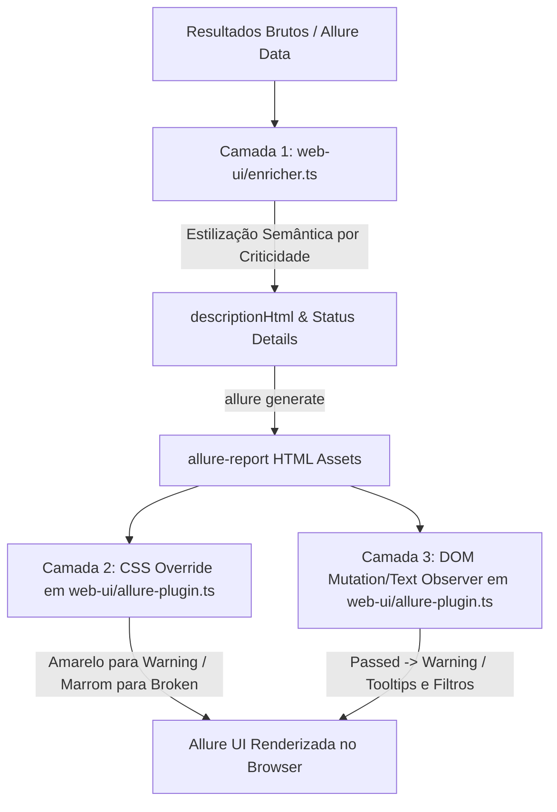

# Plano Técnico: Reclassificação Visual e Semântica de Findings Não-Bloqueantes (`017-reclassify-non-blocking-findings-status-and-colors`)

## 1. Arquitetura e Estratégia de Implementação

Para atender aos requisitos sem violar o Princípio I da Constituição (Zero Core Modification em `security-tests/`) e sem quebrar a validação de esquema interno do binário oficial `allure generate`, adotaremos uma estratégia combinada em **três camadas**:



### Camada 1: Estilização do Card de Remediação no Enriquecedor ([`web-ui/enricher.ts`](file:///home/user/felipe/speckit/assat/web-ui/enricher.ts))
* O card `asvs-remediation-box` atualmente usa estilo estático verde (`#f1f8e9`, `#2e7d32`).
* Vamos parametrizar o estilo conforme o status/severidade do achado:
  * Se `status === 'passed'` (Medium / Low / Unknown):
    * Fundo: `#fffde7` (âmbar muito suave)
    * Borda esquerda: `4px solid #f57f17` (âmbar forte)
    * Borda geral: `1px solid #ffe082`
    * Título: `📍 Localização Precisa do Finding & Evidência de Código [Warning - Não Bloqueante]`
    * Badge de Linha: `#f57f17` (amarelo/laranja)
    * Cor do texto "Como Corrigir": `#e65100`
  * Se `status === 'failed'` (Critical / High):
    * Fundo: `#ffebee` (vermelho suave)
    * Borda esquerda: `4px solid #c62828` (vermelho forte)
    * Borda geral: `1px solid #ffcdd2`
    * Título: `📍 Localização Precisa do Finding & Evidência de Código [Failed - Bloqueante]`
    * Badge de Linha: `#c62828` (vermelho)
    * Cor do texto "Como Corrigir": `#c62828`

### Camada 2: Overrides Globais de CSS ([`web-ui/allure-plugin.ts`](file:///home/user/felipe/speckit/assat/web-ui/allure-plugin.ts))
Injetar no método `getAllurePluginCss()` as regras prioritárias (`!important`):

1. **Status `passed` -> Amarelo (`Warning`)**:
   * `.bar__fill_status_passed { background: #fbc02d !important; }`
   * `.y-label_status_passed { background: #fbc02d !important; color: #212121 !important; }`
   * `.n-label_status_passed { color: #f57f17 !important; border-color: #fbc02d !important; }`
   * `.alert_status_passed { background: #fff9c4 !important; color: #f57f17 !important; }`
   * `.text_status_passed { color: #f57f17 !important; }`
   * `.message_status_passed { border-color: #fbc02d !important; }`
   * `.status-details_status_passed { background: #fffde7 !important; border-color: #fbc02d !important; }`
   * `.chart__legend-icon_status_passed { background: #fbc02d !important; }`
   * `.chart__fill_status_passed { fill: #fbc02d !important; }`
   * `.label_status_passed { background: #fbc02d !important; color: #212121 !important; }`
   * Substituição do ícone de checkmark pelo triângulo de alerta:
     ```css
     .fa-check-circle.text_status_passed::before,
     .node__anchor .fa-check-circle::before {
       content: "\f071" !important; /* FontAwesome fa-exclamation-triangle */
       color: #f57f17 !important;
     }
     ```
   * Substituição do texto da tag de status no cabeçalho do teste:
     ```css
     .pane__header .label_status_passed {
       font-size: 0 !important;
     }
     .pane__header .label_status_passed::after {
       content: "Warning" !important;
       font-size: 11px !important;
       font-weight: 700 !important;
       text-transform: uppercase !important;
       letter-spacing: 0.5px !important;
     }
     ```

2. **Status `broken` -> Marrom**:
   * `.bar__fill_status_broken { background: #795548 !important; }`
   * `.y-label_status_broken { background: #795548 !important; color: #ffffff !important; }`
   * `.n-label_status_broken { color: #5d4037 !important; border-color: #795548 !important; }`
   * `.alert_status_broken { background: #efebe9 !important; color: #4e342e !important; }`
   * `.text_status_broken { color: #5d4037 !important; }`
   * `.message_status_broken { border-color: #795548 !important; }`
   * `.status-details_status_broken { background: #efebe9 !important; border-color: #8d6e63 !important; }`
   * `.chart__legend-icon_status_broken { background: #795548 !important; }`
   * `.chart__fill_status_broken { fill: #795548 !important; }`
   * `.label_status_broken { background: #795548 !important; color: #ffffff !important; }`
   * `.node__anchor .fa-exclamation-circle.text_status_broken { color: #5d4037 !important; }`

### Camada 3: Substituição Dinâmica de Textos no DOM ([`web-ui/allure-plugin.ts`](file:///home/user/felipe/speckit/assat/web-ui/allure-plugin.ts))
Injetar script no ciclo de renderização do Allure para:
* Substituir ocorrências de "Passed" / "Passou" nos filtros de status e tooltips por "Warning (Non-Blocking)" ou "Warning".
* Atualizar o texto da legenda do gráfico de pizza/donut para "Warning" em vez de "Passed".

---

## 2. Compatibilidade e Não-Regressão
* **Princípio I (Zero Core Modification)**: Nenhuma alteração em arquivos de `security-tests/` ou `shared-*.json`.
* **Allure CLI Compatibility**: Como o valor interno `"passed"` é mantido no Allure Schema e remapeado esteticamente na UI, `allure generate` continua executando sem erros e gerando dados canônicos perfeitamente.
* **Testes Automatizados**: A suite de testes em `web-ui/*.test.ts` permanecerá 100% verde.

